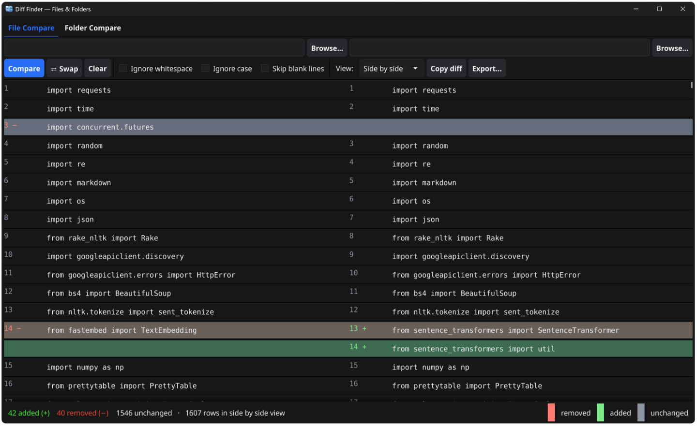

# Diff Finder 🔍

**Diff Finder** is a native Windows desktop application built with **Go** and the **Fyne UI toolkit**. It compares files and folders, presenting differences in a clear, easy-to-read visual format.

With window-wide drag-and-drop support, side-by-side text comparison, and recursive directory analysis, Diff Finder makes it easy to identify, navigate, and report changes.



## ✨ Features

### 📄 File Comparison

- **Multiple Views:** Switch between side-by-side and unified diff views with clear red/green highlighting and summary statistics for added, removed, and unchanged lines.
- **Quick Navigation:** Jump between changes using the **Previous** and **Next** buttons, or select a row to inspect its full text.
- **Flexible Options:** Ignore whitespace, ignore case, skip blank lines, and automatically detect binary files.
- **Export and Copy:** Copy diff results to the clipboard or export comparison reports as `.txt` files.

### 📁 Folder Comparison

- **Recursive Analysis:** Compare directory trees recursively using SHA-256 content hashing to identify matching and differing files.
- **Clear Status Indicators:** Quickly identify matching files, modified files, and files found only in the left or right directory.
- **Advanced Filtering:** Filter results by filename, show only differences, and open differing files directly in the file comparison view.
- **CSV Reports:** Export folder comparison results as CSV files for further analysis.

## 🚀 Getting Started

### Prerequisites

- [Go 1.22 or later](https://go.dev/dl/)
- A C compiler compatible with Fyne's CGO requirements, such as [WinLibs GCC](https://winlibs.com/).

Install WinLibs using Windows Package Manager:

```powershell
winget install -e --id BrechtSanders.WinLibs.POSIX.UCRT
```

### Run the Application

Run the application directly from the project directory:

```bat
go run .
```

### Build the Release Executable

Run the included build script:

```bat
build.bat
```

The script generates `DiffFinder.exe` in the project directory.

Alternatively, build the Windows release executable manually:

```bat
go build -trimpath -ldflags="-H windowsgui -s -w" -o DiffFinder.exe .
```

**Why use these build flags?**

- `-trimpath` removes local filesystem paths from the compiled binary.
- `-H windowsgui` prevents a console window from opening alongside the GUI application.
- `-s -w` strips symbol and debug information to reduce executable size.
- `-o DiffFinder.exe` explicitly sets the output filename.

> **Note:** Use `build.bat` or the equivalent command above to produce the intended release executable. A plain `go build` uses the default output name and does not apply the Windows GUI linker flag. Running `go build ./...` builds the packages but does not produce a single release executable for the application.

### Application Icon

The application icon is sourced from `icon.png`, embedded into the application using `go:embed`, and included in the Windows executable through `icon.ico` and `app_windows_amd64.syso`.

If you change the icon, regenerate the Windows resource file using `rsrc` and rebuild the application.

## 🖥️ Command-Line Usage

Launch Diff Finder from the command line to compare files or directories.

**Compare two files:**

```bat
DiffFinder.exe <left-file> <right-file>
```

**Compare two directories:**

```bat
DiffFinder.exe --folder <left-dir> <right-dir>
```

Replace the placeholders with the paths to the files or directories you want to compare.

## 🧪 Testing

Run the Go test suite from the project directory:

```bat
go test ./...
```

## 🏗️ Project Structure

```text
.
├── main.go                         # Application startup, tabs, drag-and-drop, window geometry
├── ui_file.go                      # File comparison interface and event handling
├── ui_folder.go                    # Folder comparison interface and recursive results
├── ui_file_test.go                 # Headless UI tests
├── helpers.go                      # Path, size, time, and text formatting helpers
├── winstate_windows.go              # Windows maximize-state detection using syscall
├── winstate_other.go                # Non-Windows window-state fallback
├── icon.png                         # Embedded application icon source
├── icon.ico                         # Windows executable icon
├── app_windows_amd64.syso           # Windows executable icon resources
└── internal/
    ├── diff/                        # Line-diff engine using Myers algorithm and sergi/go-diff
    └── folder/                      # Recursive folder comparison and SHA-256 hashing
```

## 🛠️ Built With

- [Go](https://go.dev/) — Application logic and core functionality
- [Fyne](https://fyne.io/) — Cross-platform GUI toolkit
- [sergi/go-diff](https://github.com/sergi/go-diff) — Text difference engine

